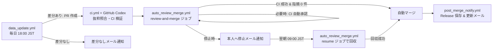
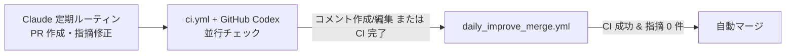

# 自動化・検証フロー全体マップ

本リポジトリで稼働している自動化（GitHub Actions・Claude Code 定期ルーティン・GitHub Codex）と、品質検証基盤の全体像をまとめた俯瞰マップです。  
各ワークフローの詳細仕様・例外ルール・障害復旧手順の正本は [AGENTS.md](../AGENTS.md) を参照してください。

---

## 1. 実行主体の役割分担

| 主体 | 担当範囲 | 備考 |
|---|---|---|
| **GitHub Actions**（全 8 ワークフロー） | 日次データ取得・検証・PR 作成・CI 実行・自動マージ・Release 保存・メール通知・障害監視・定期整理 | すべてのマージは `github.token` で実行 |
| **Claude Code 定期ルーティン** | 改善 PR（`claude/*`）の作成と Codex 指摘への修正対応 | マージ・ラベル付与は行わない（Actions 側へ委譲） |
| **GitHub Codex**（`chatgpt-codex-connector[bot]`） | PR の自動コードレビュー／取得元抜粋の照合 | スケジューラーやマージは担当しない |

---

## 2. 全体フロー

### A. 日次データ更新フロー（`data/auto-update-*`）

### B. 改善 PR 自動マージフロー（`claude/*`）

---

## 3. GitHub Actions ワークフロー一覧（全 8 本）

| ワークフロー | ファイル | 主なトリガー / 実行時刻（JST） | 役割 |
|---|---|---|---|
| **data update** | `.github/workflows/data_update.yml` | 毎日 18:00（日曜は月1全量／週次再検証）、手動 | atwiki 取得・正規化・監査・更新 PR 作成 |
| **ci** | `.github/workflows/ci.yml` | `push(main)` / `pull_request` | lint・テスト・カバレッジ・スキーマ/契約検証・actionlint |
| **auto review merge** | `.github/workflows/auto_review_merge.yml` | `data update` 完了後（`review-and-merge`）、毎日 09:00 / 手動（`resume`） | データ更新 PR の Codex レビュー待ち・CI 自動承認・自動マージ・翌朝回収 |
| **post merge notify** | `.github/workflows/post_merge_notify.yml` | PR `closed`（マージ時）、手動 | Release アセット作成・更新反映メール送信 |
| **daily improve merge** | `.github/workflows/daily_improve_merge.yml` | Codex コメント作成/編集、`ci` 完了、手動ラベル | `claude/*` 改善 PR のゲート判定・自動マージ |
| **cleanup auto update prs** | `.github/workflows/cleanup_auto_update_prs.yml` | 毎日 20:30、手動 | 期限超過の未マージ自動更新 PR を close・ブランチ削除 |
| **reports prune** | `.github/workflows/reports_prune.yml` | 毎月 1 日 18:00、手動 | 期限切れレポート削除 PR の作成（手動マージ対象） |
| **notify failure** | `.github/workflows/notify_failure.yml` | 主要 5 ワークフローの失敗完了時 | 失敗メール通知・`pipeline-failure` Issue 起票 |

---

## 4. 品質検証・不変条件テストの構成

`uv run python -m ms_data.tasks ci` で以下を一括検証します。

- **スキーマ・契約検証**: `msData.json`（厳格検証）、`data/custom_parts.json`、`data/weapons.json`、`official_overrides`、レポート契約、スナップショット復元検証
- **不変条件（プロパティベース）テスト（`Hypothesis`）**:
  - `tests/test_invariants_text_and_names.py`: MS 名・記号正規化の冪等性・可逆性・否定優先
  - `tests/test_invariants_review_and_approval.py`: レビューゲート・CI 承認の安全性・非 Codex 無影響性
  - `tests/test_invariants_rollbacks_and_overrides.py`: 公式オーバーライドの冪等性・非破壊性・巻き戻り保護の健全性
  - `tests/test_invariants_diff_model.py`: 差分サマリ・詳細・`fullst` 比較の保存則と整合性
- **状態遷移モデルのステートフル検証（`RuleBasedStateMachine`）**:
  - `tests/test_invariants_merge_state_machine.py`: 自動レビュー〜CI 承認〜マージのランダム遷移で、未通過マージ禁止・非信頼 PR 承認禁止・二重マージ禁止・正当経路の到達性を検証
- **ユニット・回帰・ワークフロー契約テスト**: `tests/test_*.py`（カバレッジ下限は `pyproject.toml` で管理）
